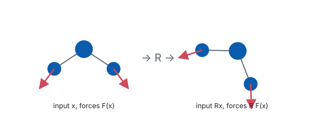

This post is a living reference for formatting. Copy from it freely. It stays a
draft, so it is visible in `quarto preview` but never published.

## Maths

Inline maths uses single dollars: an interatomic potential maps positions
$\mathbf{r}_i \in \mathbb{R}^3$ to an energy $E$, and forces are
$\mathbf{F}_i = -\nabla_{\mathbf{r}_i} E$.

Display maths uses double dollars. Add a label to number and cross-reference it:

$$
E(\{R\mathbf{r}_i + \mathbf{t}\}) = E(\{\mathbf{r}_i\})
\quad \forall\, R \in O(3),\ \mathbf{t} \in \mathbb{R}^3
$$ {#eq-invariance}

Because the energy is invariant (@eq-invariance), the forces are *equivariant*:
rotating the input rotates the forces by the same $R$.

## Code

```python
import torch

def forces(energy_fn, positions: torch.Tensor) -> torch.Tensor:
    """F = -dE/dr, via autograd. positions: (n_atoms, 3)."""
    positions = positions.detach().requires_grad_(True)
    energy = energy_fn(positions)
    (grad,) = torch.autograd.grad(energy, positions)
    return -grad
```

Inline code looks like `torch.compile`. Blocks get a copy button automatically.

## Figures

{#fig-equivariance width=80% fig-alt="Two copies of a three-atom molecule, the second rotated, with force arrows rotated by the same angle."}

Refer to figures by label: see @fig-equivariance.

## Callouts

::: {.callout-note}
## Why this matters
An equivariant model gets rotational symmetry for free, rather than having to
learn it from augmented data.
:::

Other types: `callout-tip`, `callout-warning`, `callout-important`, `callout-caution`.

## Footnotes and citations

MACE builds higher body-order messages from equivariant features
[@batatia2022mace].^[Body order is the number of atoms whose positions enter a
single term of the energy expansion.] Footnotes and citations appear in the
margin on wide screens.
